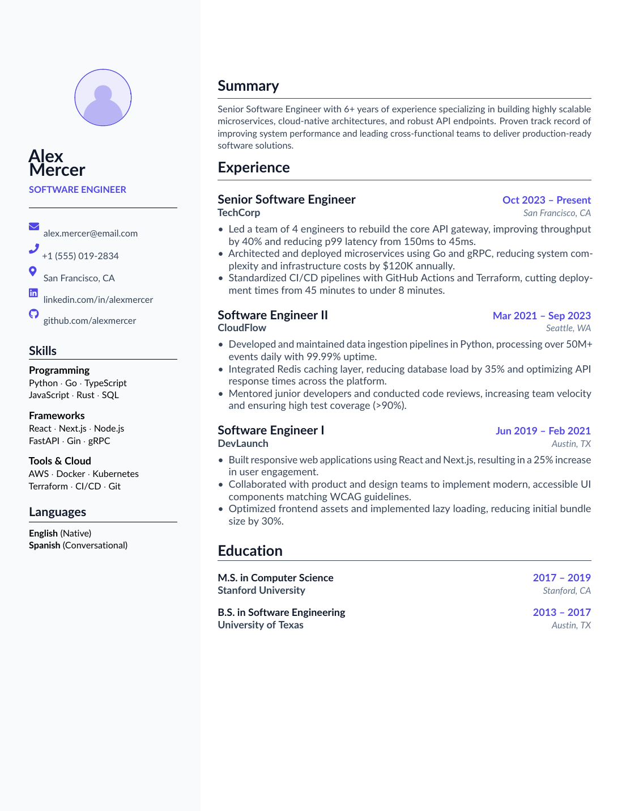

# LaTeX Resume Template — Modern Two-Column

[](https://letx.app/open?template=two-column-resume)
[](LICENSE)
[](#compile-locally)

**A modern, ATS-friendly two-column LaTeX resume template — tinted sidebar, clean typography, one page.**

Edit and compile this template in your browser at **[letx.app](https://letx.app/templates/cvs-resumes/two-column-resume/)**, with no LaTeX install and real-time collaboration. A compile takes a few seconds.



## Use it online (recommended)
**[Open this template in LetX](https://letx.app/open?template=two-column-resume)**: it becomes a new project you can edit and compile in your browser, with no LaTeX install, real-time collaboration and compiles that take a few seconds. Its page in the gallery is [here](https://letx.app/templates/cvs-resumes/two-column-resume/).

## <a name="compile-locally"></a>Compile locally
```bash
git clone https://github.com/Shahriar-Labs/latex-resume-template.git
cd latex-resume-template
latexmk -pdf main.tex
```

## More free LaTeX templates
This is one of **80+ free, open-source templates** in the [LetX LaTeX Template Library](https://github.com/Shahriar-Labs/latex-templates) — research papers, CVs, grants, lab reports, posters and more. Browse them all at **[letx.app/templates](https://letx.app/templates)**.

Built by [Shahriar Labs](https://shahriarlabs.com), makers of **[LetX](https://letx.app)** — the fast, private, real-time collaborative LaTeX editor (an Overleaf alternative).

## License
MIT — free for personal and commercial use. See [LICENSE](LICENSE).
